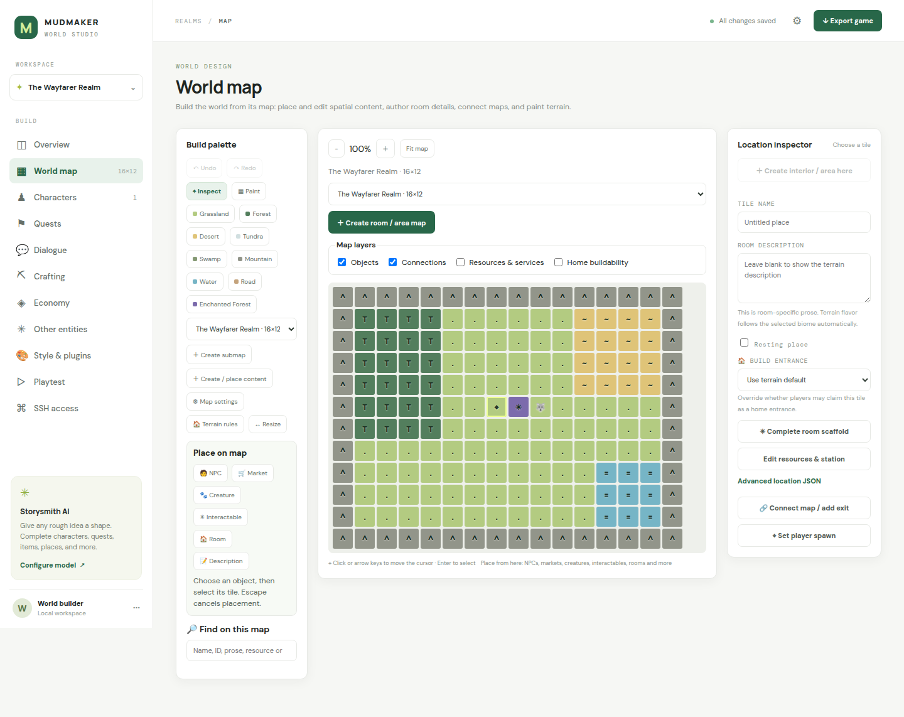
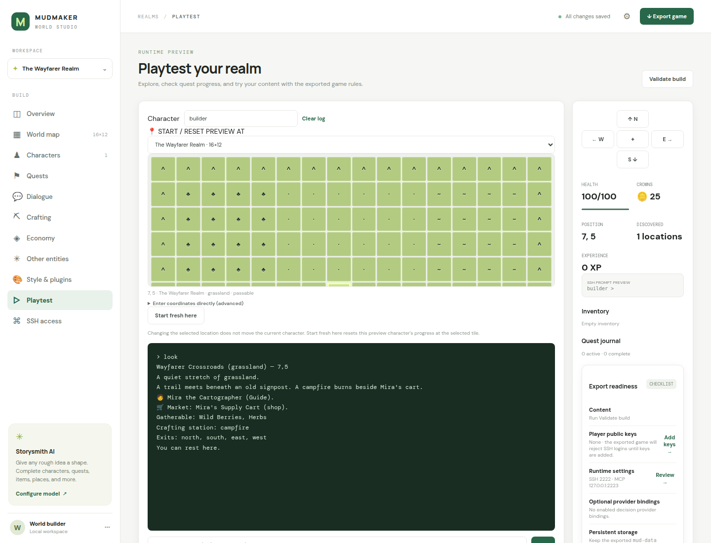
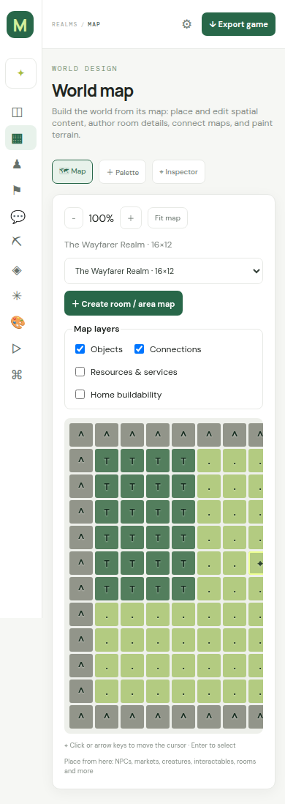

# Mudmaker

Mudmaker is a browser based workbench for creating multiplayer text adventures. It includes a biome map painter, editable world entities, SSH public key access lists, optional invited browser play, an optional OpenAI compatible content assistant, and a self contained Docker Compose export for each game.

## Screenshots

The map workspace brings terrain, placed content, map connections, and location editing together:



Playtest uses the game rules shared with exported runtimes and shows player state beside the command transcript:



The map workspace adapts to narrow screens with a compact navigation rail and map controls:



The [game engine next steps](docs/engine-next-steps.md) include a six-ticket next implementation batch for draft recovery, map reference safety, concurrent edits, validation, deployed-world upgrades, and decision responsiveness, with module pointers and acceptance checks.

The [submaps, travel, markets, and player-building plan](docs/travel-trade-and-building-plan.md) tracks implementation progress and the remaining builder, runtime, migration, and verification requirements.

The [player access guide](docs/player-access-plan.md) describes the optional invited browser client shipped alongside SSH access, its installable offline shell, text-only mode, shared player sessions, and HTTPS deployment setup.

The [style guide](docs/style-guide.md) defines the modern builder and terminal experience, including emoji, icons, semantic color, animation, accessibility, and configurable presentation.

The [decision-controlled game systems plan](docs/decision-controlled-npcs-plan.md) covers builder-authored behaviors, typed model adapters such as Jev/Laya, bounded actions, playtest inspection, persistence, fallback behavior, and runtime exports.

The [builder improvement plan](docs/builder-improvement-plan.md) prioritizes reliable editing, a unified map workspace, guided content forms, decision inspection, and the playtest/export workflow.

Applied world edits have a browser-local recovery copy per tab until saving succeeds. After a reload, choose Restore draft or Discard draft before editing. Restoration retains the original server revision so concurrent changes are not overwritten. Save failures offer Retry and a JSON draft download. Revision conflicts also offer Review conflict: independent changes are combined, overlapping changes require a draft/server choice, and applying still checks the reviewed server revision. Unapplied modal fields are not yet included in recovery; browser storage availability and capacity can limit recovery.

Use the [map builder guide](docs/map-builder-guide.md) for the map-centered build workflow, map cursor controls, map exits, and placing or editing world content without hand-editing JSON.

## Run the workbench

```sh
docker compose up --build
```

Open [http://localhost:8081](http://localhost:8081). The named `mudmaker-data` volume stores worlds and nonsecret authoring settings. The UI binds to loopback by default. To expose it to your network, copy `.env.example` to `.env`, set `MUDMAKER_BIND=0.0.0.0`, and set a private `MUDMAKER_ADMIN_PASSWORD`; the app enforces HTTP Basic authentication whenever an admin password is set and refuses non-loopback binding without one. Keep `.env` private. For local Python development, install `pyproject.toml` dependencies and run `uvicorn app.main:app --reload --port 8080`.

## Build a game

Use the left navigation to paint the map, edit characters and quests, define recipes and vendors, and add player SSH public keys. Storysmith accepts partial JSON scaffolds and focused instructions. Set the Chat Completions compatible base URL and model in the settings panel (a bare server URL defaults to `/v1`; explicit API paths and full `/chat/completions` URLs are preserved); provide `MUDMAKER_OPENAI_API_KEY` through the private `.env` file. The key is not stored in the database or game exports. Generated content remains an editable draft until applied.

Use **Terrain rules** on the map to assign gatherable items and shared supply counts to each terrain type; players can gather those items from any tile of that terrain. Local deposits remain editable in a tile’s **Edit resources & station** panel. Creature `loot` entries grant item drops to each player who contributed to a victory. In an item editor, **Items received when used** configures item conversions: using one Filled Water Skin can grant one Water Skin; the consumed item and any healing or flag effects are handled by the runtime.

Select **Export game** to download a project ZIP. Extract it, then run `docker compose up -d --build` in that directory. The exported project builds a standalone runtime image from its standardized Python base, exposes SSH on port 2222, and mounts the authored world read only. `world/players.json` binds each login name to one SSH public key; a persistent server host key and player save database are stored in the Compose volume. The runtime accepts public key login only.

The runtime supports simultaneous SSH sessions and `help`, `look`, `map`, `exits`, `journal`, `note`, `track`, cardinal `go`, `talk`, dialogue `choose`, quests, gathering, inventory, item use, vendor buy/sell, recipe lookup, batch `craft`, `drop`/`take` shared ground items, `attack`/`flee` combat, safe `rest`, and `stats`. Optional home building adds private submaps, terrain-based tile costs, storage, visitor/collaborator permissions, and author-configured player barter. Barter uses expiring offers and explicit acceptance; both players must share a tile and have home access to trade inside a private area. Per-player location, discovered places, currency, inventory, and quest status persist in SQLite. Quest objectives support discovery, visits, conversations, collection, crafting, delivery, and custom interactions. Structured dialogue choices can grant items, set flags, or accept quests. Finite resource supplies and vendor stock are shared between players. Custom biomes and room scaffolds compile into the playable map.

## Project layout

- `app/main.py`: HTTP API, sample world, AI scaffold completion, and game project export.
- `web/`: single page authoring interface and styles.
- `compose.yaml`, `Dockerfile`: authoring workbench deployment.

## Complete a partial scaffold

Open any entity editor, change its JSON, and select AI assistance. The assistant receives the current draft. Missing fields, empty strings, null values, and empty collections are filled; authored values (including `false` and `0`) are preserved. Partial nested objects and list entries are completed recursively. Review and edit the result before applying it.

Supported templates include NPCs, quests, recipes, vendors, items, biomes, rooms, dialogues, descriptions, worlds, and custom entities. Custom entity actions use typed effects rather than executable code. AI operates during authoring; deployed games require no model service. Local OpenAI-compatible providers can run without a key. Optional JSON mode is available for providers that support it.

Use **Playtest** to exercise the same engine used by exports, and **Validate build** to catch broken references, invalid objectives, and incomplete playable content. Drafts may remain incomplete while editing; export requires valid content.

## Development and verification

```sh
python -m venv .venv
.venv/bin/pip install -e '.[dev]'
.venv/bin/uvicorn app.main:app --reload --port 8080
.venv/bin/python -m unittest discover -s tests -v
.venv/bin/python -m scripts.verify_export
.venv/bin/python scripts/verify_exported_decision_runtime.py
```

The final command builds a temporary exported game, connects two real SSH clients, checks authentication, quests, crafting, shared trading, chat, and restart persistence, then removes its temporary containers and volume.

The decision-runtime check builds a separate exported game and connects over SSH to a local System One fixture. It verifies the exported provider call, applies a bounded NPC move, and checks that player commands stay responsive during delayed inference. It needs Docker Compose and makes no external model calls.

The portable content contract lives in `app/templates/content.py`; `game_engine.py` supplies both browser playtesting and deployed gameplay. Exported projects include a reusable Docker build stage: `docker build --target mudmaker-base -t mudmaker-base:local .`. Set `MUD_SSH_PORT` to change an exported game's host port.

## MCP for AI authoring and live management

`docker compose up -d --build` also starts the creator MCP service at `http://localhost:8082/mcp`, sharing the workbench's world database. Both creator and game servers use Streamable HTTP with a bearer token. Retrieve the automatically generated creator token privately:

```sh
docker compose exec -T creator-mcp cat /data/creator-mcp-token
```

Set your MCP client's URL and `Authorization: Bearer <token>` header. Alternatively, supply `MUDMAKER_MCP_TOKEN` in the private `.env` (at least 24 characters). Set `MUDMAKER_MCP_PORT` to change the host port. `MUDMAKER_MCP_BIND` defaults to loopback; use `MUDMAKER_MCP_ALLOWED_HOSTS` for additional proxy/private-network Host headers. Use your TLS proxy when exposing the endpoint beyond the local host.

Creator tools list/create/read/save worlds, upsert any entity, edit map tiles, complete partial scaffolds, validate, playtest, inspect decision controllers, pause/resume isolated playtest controllers, and export a ZIP. Read `get_world` for the revision before writing. Stale edits are rejected, including browser saves after an MCP edit. Copy any unsaved browser draft before reloading. `complete_scaffold` can merge content generated by the connected AI client or call the workbench's configured OpenAI-compatible provider. Completion returns a draft; saving is a separate tool call.

Exported games expose their own MCP endpoint on loopback port 2223 with a separate token. Game Master tools inspect players, grant typed effects, teleport characters, announce messages, manage special events, inspect decision controllers, and pause/resume them by owner type. The `special_event` prompt and `event_schema` resource provide the AI client with the playable content contract. The client can generate NPCs, dialogues, quests, crafting, vendors, and custom interactions, then draft, review, and activate an event. Events persist across restarts and may have an expiry time. Grants use idempotent request ids, and management actions are audited. Each exported README contains full setup instructions.

The runtime `map` command hides undiscovered locations with `?`. It marks you with `@` and online players on discovered tiles with `&`, with names and coordinates in the legend. Offline players and players in unexplored places are not shown.

The builder exposes item icons and equipment slots, creature icons and combat values, player emotes, and exported SSH/MCP bind and port defaults. Edit realm connections and emotes under **Realm details**; edit item or creature options in **Other entities**. Playtest shows an SSH prompt preview with equipped icons. These saved world settings carry through validation and Docker export. Use `equip <item>` / `unequip <item|slot>` and `emote <id>`; nearby multiplayer clients receive emote broadcasts. The MCP token remains a private runtime secret.

Use **Style & plugins** to choose the currency icon, terminal color behavior, and ASCII or icon maps. Biomes can define their own color, one-character ASCII symbol, and optional emoji map icon. `NO_COLOR` and dumb terminals are respected in automatic color mode. These settings are stored with the world and included in exports.

Mechanics plugins are trusted Python modules stored in the world and exported under `plugins/`. Each module defines `register(api)` and can register commands with `api.command(name, handler, help_text)` or custom action effects with `api.effect(name, handler)`. Command handlers receive `(engine, sqlite_connection, player_state, username, argument)`; effect handlers receive `(engine, player_state, effect)`. Declare custom effect ids in the plugin editor so world validation accepts them. Plugin code executes inside the creator during playtest and inside the game container at runtime; use only code you trust. Disable a plugin to keep it out of runtime exports.

Additional checks:

```sh
.venv/bin/python -m scripts.verify_mcp
.venv/bin/python -m scripts.verify_gui
.venv/bin/python -m scripts.verify_player_web
```

The GUI check uses an isolated database and a fixture OpenAI-compatible endpoint. It uses an installed Chrome/Chromium browser (`MUDMAKER_BROWSER` can select its executable); alternatively install Playwright's Chromium with `.venv/bin/playwright install chromium`. Screenshots and the downloaded game are written to `artifacts/gui/`. The MCP check uses real HTTP connections through the official MCP client and isolated creator/runtime data. The player web check builds a temporary Compose export, issues browser invitations, tests secure cookies and SSH/web chat, runs the client in Chromium through text-only and offline-shell flows, then removes its container and volume.

## Exploration and playtesting

The map editor has undo/redo buttons and Ctrl+Z/Ctrl+Shift+Z history. Tiles show the spawn, NPCs, vendors, and interactions; custom location details include a resting-place switch. Content lists support text search, entity type filters, and duplication. The playtest has a movement pad, command shortcuts, ↑/↓ command history, a clearable log, and live health, currency, position, inventory, and quest counts. Use Ctrl+S to save.

At campfires, inns, and marked rest areas, `rest` restores health. `journal` lists discovered locations and your notes; write with `note <text>` and clear with `note clear`. `track <quest>` pins active objective progress to `look`; use `track off` to clear it. `recipes` shows ingredient counts, station requirements, and available batches; `craft <recipe> <count>` makes multiple batches atomically. `drop <item> <count>` and `take <item> <count>` put supplies on or take supplies from shared ground at the current location.


Creatures support shared health, turn based attacks, fleeing, safe recovery after knockout, XP, item drops, respawn timers, and `defeat` quest objectives. Creatures retain shared health and defeated state across sessions. Every player who contributed damage receives the authored XP and loot when the creature falls. In a creature's **Spawn area** editor, enable area spawns and enter a rectangle such as `{ "x": 4, "y": 3, "width": 5, "height": 4 }`. The initial location must be inside this rectangle, which must include a passable tile on the creature's selected map. After the respawn timer, the creature returns at a random passable tile within the area.

The map is the default build page, with a palette, central zoomable map, and selected-location inspector. Each map retains its own session view position. On compact screens, use the Map, Palette, and Inspector tabs.

Terrain painting fills default titles and descriptions from the terrain definition (including custom biome prose). Blank inspector fields show those defaults. Changing a tile with authored text, resources, rooms, services, outgoing connections, buildability overrides, or placed objects opens a keep-content checklist. All existing content is kept by default; unchecking text resets it to the new terrain defaults, and unchecking other content removes it. Cancel preserves the tile, and Undo restores the full change. Removing a character or object referenced by a quest may require updating that quest before validation succeeds. These edits are saved in the world and carried into playtests and exports.

Terrain regression checks:

```sh
node tests/browser/terrain-edit.test.cjs
.venv/bin/python -m scripts.verify_terrain_edit
```

To create an interior or area, select its entrance tile in **World map** and click **Create interior / area here** in the inspector, or **Create room / area map** above the map. Choose a name, dimensions (4–64 tiles per side), and starting terrain. The checked entrance option connects the selected tile to the new map and adds a return exit; uncheck it for an independent map. The new map opens immediately for painting and content placement. Use the map dropdown above the canvas to switch areas. Creation and its connections can be undone together.

Verify the submap authoring and travel/export path with `.venv/bin/python -m scripts.verify_submap_creation`.
