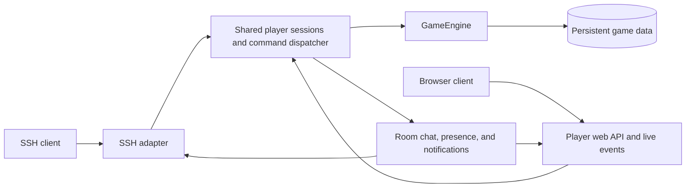

# Player access options

Implementation plan, 2026-10-03. The first optional browser client is now packaged with exported games and can be enabled in the builder. SSH remains the primary client; browser access is off by default.

## Recommended player experience

Offer a **Play in browser** link beside the SSH connection instructions. An invited player opens the link, claims their account, selects their character, and enters a readable text adventure. No terminal application or SSH key setup is required for browser-only players.

The first browser client should have a scrolling transcript, a command box, movement buttons, and context-sensitive actions such as Talk, Gather, Buy, Inventory, and Quests. A compact location/status panel can grow into a map later. Keep free-form commands available for experienced players. On a phone, use large buttons, a collapsible status panel, and a transcript that remains readable above the keyboard. Support keyboard navigation, screen readers, reduced motion, and text scaling.

Actions come from server-authorized game state. Disable unavailable actions with a readable reason and check them again when submitted. The browser must not calculate prices, permissions, quest progress, or combat outcomes independently.

## Alternatives

| Method | Player experience | Engineering scope | Suggested place |
| --- | --- | --- | --- |
| SSH | Existing terminal and public-key login | Preserve and improve current path | Primary, always available by default |
| Browser terminal | Open a page and type the same commands into a terminal-like transcript | Shared browser session with guided controls hidden | Text-only mode in the same browser client |
| Guided browser client | Transcript, movement controls, contextual action buttons, inventory and quest panels | Same connection plus structured state/action presentation | First optional interface for less technical players |
| Installable web app | Browser client launched from a home-screen icon, with a clear disconnected state | HTTPS, a web manifest, install icon, and a static shell cache | Implemented as a delivery mode of the same client; gameplay still requires a connection |
| Dedicated desktop/mobile app | Separate packaged application | Packaging, updates, platform support, and the same player API | Defer until browser limitations justify it |
| Chat-platform commands | Play through short messages and buttons | Identity linking and adaptation of room events to chat threads | Later experiment; less suitable for a continuous shared transcript |

A browser terminal can call the shared game session API directly. A browser-to-SSH proxy would introduce server-side SSH credential custody or forwarding and still need browser login; it offers little benefit here. An installable web app is a presentation/delivery mode of the browser client, not another runtime or identity system.

## Shared runtime design

Today `app/templates/mud_runtime.py` owns active sessions, `who`, `say`, `tell`, emote broadcasts, and scheduled decision notifications. `GameEngine.execute` and `snapshot` already supply the game rules and state. Extract the session behavior before introducing another transport so chat and online presence work across clients.



Initial module boundaries:

- `player_sessions.py`: authenticated principal-to-character binding, command dispatch, online presence, room broadcasts, bounded outbound queues, and cleanup.
- `player_web.py`: player authentication and HTTP state/command endpoints. The first version polls for room messages and state; a WebSocket event channel can replace polling after the session contract is stable. This is separate from the privileged runtime MCP interface.
- `player_client/`: exported static browser assets, sharing structured player state contracts with builder playtest where practical.
- SSH adapter: retain public-key authentication, terminal formatting, and SSH exec commands while using the shared dispatcher and ownership checks.

Both transports use one engine instance and the same game database. Do not run an independent web engine against a copy of the world. Keep a single runtime process initially; scaling to several processes needs explicit shared presence/event coordination.

Use structured events such as transcript output, player state, room chat, and session status. Give events session-local sequence numbers; after a reconnect, refresh authoritative state and clearly mark any transcript gap. Render user/chat content as text, never trusted HTML, and keep terminal escape formatting in the SSH adapter.

## Identity and reconnects

The first release uses the player name as the character ID. A browser player who uses the same name as an SSH player reaches the same save; changing names currently creates a different save and needs an explicit migration. Browser access never lets a player choose a different character after login.

The operator issues an expiring, single-use browser invitation from the running container; a browser-only player does not need an SSH key. The player chooses a password on first use. Invitation tokens are stored only as hashes and printed once by the operator command. Password hashes are salted scrypt values in the persistent game database and never enter authored world JSON. Browser login sessions are held in memory, use secure HTTP-only SameSite cookies, and require a fresh login after a runtime restart. Password reset invalidates existing cookies against a stored account version; an operator can then issue a new invitation.

Use HTTPS for browser access: the session cookie is secure-only. SameSite strict cookies protect the cookie-authenticated endpoints; the browser listener is separate from the privileged runtime MCP interface and never receives its bearer token or SSH private keys. Login throttling and persistent cross-process revocation remain future hardening work.

Keep one active controlling session per character across SSH, web, and SSH exec. A second active controller is rejected. Browser sessions expire after 45 seconds without a poll or command, or immediately through Leave game. Explicit takeover and cross-process session coordination remain future work.

## Builder and export options

The **Player access** area retains SSH keys and adds a Web section. SSH stays available for existing worlds; Web defaults to disabled. A builder can enable it and choose its port. Invitations are created by the runtime operator for any username, so a web-only character does not need an SSH key. Interface controls only change what the client shows; they do not grant gameplay capabilities.

Implemented runtime configuration; browser mode is a per-device preference:

```json
{
  "runtime_config": {
    "ssh_port": 2222,
    "player_web": {
      "enabled": false,
      "port": 8080
    }
  }
}
```

Public origins and port bindings need deployment overrides. Invitations, passwords, sessions, signing secrets, and provider credentials do not belong in this configuration.

When enabled, export browser assets, player API code, documented environment examples, and an opt-in web listener/Compose port binding. The host port binds to loopback by default and can sit behind HAProxy TLS termination. The initial client polls HTTP and does not require WebSocket forwarding. NetBird can provide private access when desired. When disabled, export does not publish the port. Preserve `mud-data` for identity records as well as game saves.

The builder's web playtest should exercise the same command/state/session contracts with isolated preview identities. It must not require a deployed player's invitation or credentials, or expose builder/management endpoints to player clients.

## Implementation slices

1. **Extract shared sessions.** Initial single-process slice is implemented: SSH and browser share a session registry and command dispatcher, presence, room chat, tell, emotes, and decision notifications. Preserve these paths if sessions are later moved to a separate module.
2. **Add accounts and browser invitations.** Implemented: the operator issues a one-use 24-hour invitation for an SSH or web-only player name. First login sets a password stored as a salted scrypt hash in `mud-data`; later logins use that password. One active controlling session per name is enforced across SSH and web. Cross-process revocation remains future work.
3. **Ship a minimal web transcript.** Implemented: exported login, transcript, status, command entry, polling, and cross-transport room chat. A per-device text-only mode hides guided buttons and enlarges the transcript. Mutating commands are submitted once and are not automatically retried. Add sequence IDs and reconnect gap reporting before replacing polling with WebSockets.
4. **Add guided controls.** Implemented: movement, map, inventory, quests, journal, recipes, help, and server-derived nearby actions for talking, starting eligible quests, shopping, gathering available resources, attacking nearby creatures, interacting, and selecting currently available dialogue choices. The command engine still checks every action when submitted. Responsive phone layout and the browser verifier cover a starter quest and dialogue response. Remaining: structured quest progress and home panels, then the complete gathering/crafting/delivery and building journey.
5. **Carry it through builder and Compose export.** Implemented: disabled-by-default builder toggle and port, bundled assets and API, loopback-only host port default, HTTPS-only session cookies, and deployment/invitation instructions. Validate a real HAProxy/TLS deployment and add browser access to export readiness.
6. **Add installable presentation.** Implemented: standalone web manifest, vector icon, install prompt, iOS home-screen hint, offline/connection status, and a service worker that caches only the static shell. API requests remain network-only, commands are never queued offline, and stale shell versions are removed on activation. The browser verifier reloads the app shell offline and confirms the saved character reconnects; installation from a phone or desktop browser menu still needs device verification.

Focused API coverage checks invite redemption, password login/logout, shared player state, queued notifications, duplicate active sessions, install metadata, static-only service worker scope, and disabled/enabled export packaging. The isolated exported Compose and Chromium verifier checks SSH and browser login, secure cookie flags, two-way cross-transport chat, guided quest and dialogue actions, text-only controls, offline command rejection, cached-shell reload, and session reconnection. A live HTTPS proxy deployment, install flow on a phone, slow client queue behavior, and the complete guided quest/home browser journey still need verification.
